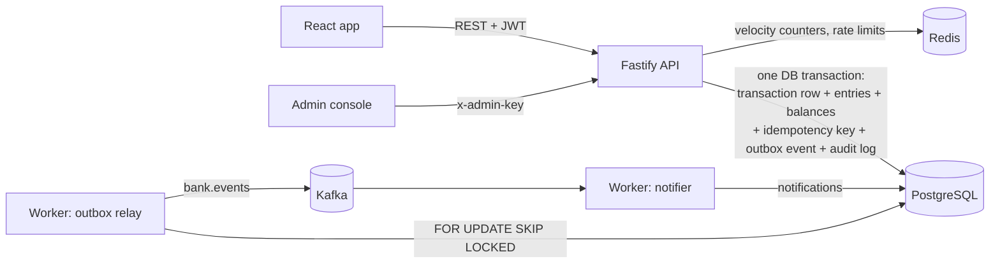
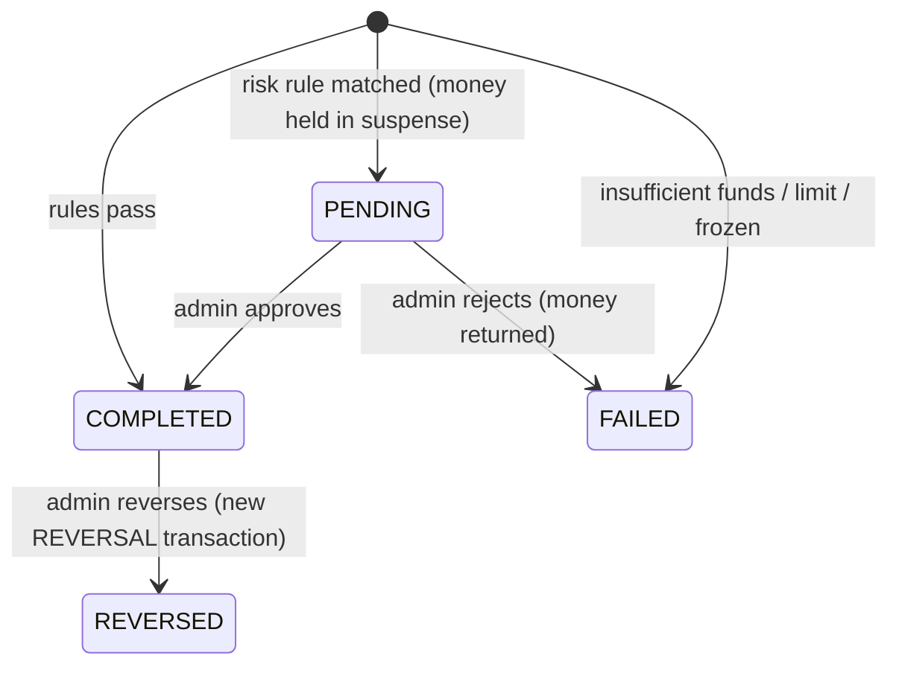

# NeoBank

A simulated **digital bank**. Customers open accounts, add money, save beneficiaries, send transfers, download statements and get notifications. Bank staff review suspicious transfers, reverse mistakes, freeze accounts and check that the books balance.

It isn't a CRUD app. The interesting part is **moving money correctly**: no money created or lost, no double charges when a request is retried, and no overdrafts when many requests arrive at once. Every guarantee is enforced in code, enforced again by the database, and proven by a test.

**Stack:** TypeScript · Node.js · Fastify 5 · PostgreSQL 17 (raw SQL with `pg`) · Redis · Kafka · React 19 + Vite + Tailwind + TanStack Query · Docker · Vitest

---

## Contents

1. [Run it](#1-run-it)
2. [The big picture](#2-the-big-picture)
3. [Concepts, step by step](#3-concepts-step-by-step)
4. [One transfer, start to finish](#4-one-transfer-start-to-finish)
5. [API](#5-api)
6. [Tests: what each one proves](#6-tests-what-each-one-proves)
7. [Project structure](#7-project-structure)
8. [Trade-offs and next steps](#8-trade-offs-and-next-steps)
9. [Interview cheat sheet](#9-interview-cheat-sheet)

---

## 1. Run it

Requires Docker and Node.js 22 or later.

```bash
npm install
docker compose up -d          # Postgres :5435, Redis :6382, Kafka :29093
npm run seed                  # creates the tables and demo data

npm run dev:api               # API on http://localhost:3100   (Swagger: /docs)
npm run dev:worker            # outbox → Kafka → notifications
npm run dev:web               # UI on http://localhost:5175
```

No `.env` file is needed: every setting has a local default. See [.env.example](.env.example).

| Who | Login |
| --- | --- |
| Customers | `asha@neobank.dev`, `rahul@neobank.dev`, `priya@neobank.dev` — password `Password@123` |
| Admin console (`/admin`) | key `dev-admin-key` |

The seed leaves one transfer of every kind: completed, **pending review** (Asha's ₹55,000 rent), **failed** (Rahul's ₹90,000 with only ₹40,000 available) and **reversed** (Asha's ₹1,200 sent twice).

Tests use a separate `neobank_test` database and Redis database 1, so they never touch your demo data:

```bash
npm test
```

---

## 2. The big picture



There are two processes, both built from one codebase:

| Process | Command | Job |
| --- | --- | --- |
| **API** | `npm run dev:api` | Handles every request. All money movement happens here, inside database transactions. |
| **Worker** | `npm run dev:worker` | Publishes saved events to Kafka, and consumes them to create customer notifications. |

**PostgreSQL is the source of truth.** Redis holds short-lived counters. Kafka carries events to other systems. If Redis or Kafka goes down, no money is lost.

---

## 3. Concepts, step by step

Each step builds on the one before it. Links point at the code that does it.

### Step 1: Money is stored as whole paise, never as decimals

`₹1,250.50` is stored as `125050`. All money columns are `bigint`.

**Why:** computers store decimals approximately. In JavaScript, `0.1 + 0.2 === 0.30000000000000004`. In a bank, those tiny errors add up. Integers are exact. The API accepts and returns paise, and the UI converts to rupees only for display. See [money.ts](apps/api/src/lib/money.ts).

### Step 2: Accounts, including the bank's own

Every customer account has a `balance`. The bank also has two **system accounts** of its own ([001_init.sql](apps/api/src/db/migrations/001_init.sql)):

| System account | What it represents |
| --- | --- |
| `BANK-CASH-INR` | The outside world. When a customer adds ₹1,000 by UPI, the money comes **from** here. Its balance goes negative, and that negative number is exactly how much customer money the bank is holding. |
| `TRANSFER-SUSPENSE-INR` | A holding area. A suspicious transfer waits here until staff review it (see step 10). |

Because of these two accounts, every movement always has a "from" and a "to", even a deposit.

### Step 3: Double-entry bookkeeping

This is the core idea of the project. Money is never created or destroyed; it only moves. So every movement is written twice: once as money **out** of one account and once as money **in** to another, for the same amount.

There are two tables for this:

- **`transactions`**: one row per business event ("Asha sent Rahul ₹2,500"), with its status.
- **`entries`**: the journal, like lines in a passbook. Each step writes one **DEBIT** (money out) and one **CREDIT** (money in).

```text
Asha sends ₹2,500 to Rahul        (transaction NB20261025…)

  account   direction   amount    balance_after
  Asha      DEBIT        2,500         7,500
  Rahul     CREDIT       2,500         2,500
                        ───────
            debits = credits  ✅
```

A deposit looks the same, with `BANK-CASH-INR` on the debit side.

Three things follow from this:

- **Every transaction balances**: its debits equal its credits.
- **All balances in the bank add up to zero.** Customer money (positive) is exactly offset by BANK-CASH (negative). If the total isn't zero, something is wrong (see step 15).
- **`accounts.balance` is a cache.** The real truth is the entries. The balance is stored for speed, and reconciliation checks it against the entries.

All balance changes happen in one function, [`moveMoney()`](apps/api/src/ledger/ledger.ts). It writes one debit and one credit every time, so no other code can change a balance on its own.

### Step 4: The database is the last line of defence

Code has bugs. So the most important rules are also written into the database, where no code path can skip them:

| Rule | How the database enforces it |
| --- | --- |
| Debits = credits for every transaction | A **constraint trigger** that is `DEFERRABLE INITIALLY DEFERRED`, so it runs at `COMMIT`. A transfer writes the debit first and the credit second; checking at COMMIT means the half-written moment in between can never be saved. |
| History can't be edited | Triggers reject any `UPDATE` or `DELETE` on `entries` and `audit_logs`. Mistakes are fixed by adding new rows (step 11). |
| No customer overdraft | `CHECK (kind = 'SYSTEM' OR balance >= 0)` |
| No transfer to the same account | `CHECK (from_account_id <> to_account_id)` |

### Step 5: Atomicity — all or nothing

A transfer changes several rows: two balances, two entries, the transaction row, an event and an audit line. If the server crashed halfway, Asha could lose money that never reached Rahul.

So each money operation runs inside one **database transaction** (`BEGIN … COMMIT`). If anything fails, `ROLLBACK` undoes all of it. This is what the **A (atomicity)** in **ACID** means. See [`withTransaction()`](apps/api/src/db/pool.ts).

### Step 6: Concurrency — two requests at the same moment

**The problem (a race condition):** Asha has ₹1,000. Two ₹1,000 transfers arrive at the same time:

```text
Request 1: read balance → ₹1,000 ✓ enough
Request 2: read balance → ₹1,000 ✓ enough      (request 1 hasn't saved yet)
Request 1: balance = 0
Request 2: balance = 0 → Asha spent ₹2,000 she never had
```

**Fix 1: row locks.** Before checking the balance, [`lockAccounts()`](apps/api/src/ledger/ledger.ts) runs `SELECT … FOR NO KEY UPDATE`. Request 2 now **waits** until request 1 commits, then reads the new balance (₹0) and fails cleanly. The test fires 50 transfers of ₹100 at a ₹1,000 balance at once, and exactly 10 succeed.

**Fix 2: lock in a fixed order to avoid deadlocks.** If transfer 1 (A→B) locks A and transfer 2 (B→A) locks B, each then waits for the other forever. That's a **deadlock**. We always lock accounts **sorted by id**, so both transfers try A first and one simply waits for the other. If Postgres still reports a deadlock, `withTransaction()` retries the whole transaction after a short random wait.

**Why `FOR NO KEY UPDATE` and not `FOR UPDATE`?** Inserting a row that references an account (a transaction or an entry) makes Postgres take a light *KEY SHARE* lock on that account, to stop it being deleted mid-insert. `FOR UPDATE` conflicts with KEY SHARE, so two transfers that had each inserted a row would block each other. `FOR NO KEY UPDATE` is the lock Postgres uses anyway when updating non-key columns like `balance`, and it doesn't conflict. The tests found this bug: 50 parallel transfers hung until the lock type was changed.

### Step 7: Idempotency — no double charges

**The problem:** the phone sends "pay ₹500", the server does it, but the response is lost on a bad network. The app retries. Without protection, the customer pays twice.

**The fix:** the client sends an `Idempotency-Key` header, a random id created once per payment attempt (the UI creates one each time the Send dialog opens). In [idempotency.ts](apps/api/src/ledger/idempotency.ts):

1. The key is inserted into `idempotency_keys` **inside the same database transaction** as the transfer. The two are saved together or not at all.
2. If the key already exists, we don't move money again. We return the **stored response** with the header `idempotent-replayed: true`.
3. If two identical requests arrive at the same instant, the second `INSERT` waits on the primary key until the first commits, then replays its response. Ten parallel identical requests produce exactly one transfer.
4. A fingerprint (hash) of the request body is stored too. Reusing a key for a *different* request, such as a new amount, is rejected with `409 IDEMPOTENCY_KEY_REUSED`.
5. Failures are stored too. Retrying a transfer that failed for insufficient funds replays the same failure instead of trying again.

### Step 8: The transaction lifecycle (a state machine)



Each move is checked under a row lock (`lockTransaction()` in [transfer.service.ts](apps/api/src/modules/transactions/transfer.service.ts)). For example, you can only approve a `PENDING` transfer. Clicking "Approve" twice gives `409 INVALID_STATUS` the second time, so admin actions are naturally safe to repeat.

**Recording failures with a savepoint.** A failed transfer should still appear in the customer's history. But when the balance check fails, we're in the middle of a database transaction. A **savepoint** is a bookmark inside a transaction: we set one just before moving money, and on a business-rule failure we `ROLLBACK TO SAVEPOINT`. That undoes only the money part, and we then mark the row `FAILED` with a reason and commit.

### Step 9: Daily transfer limits

Each account has a `daily_limit` (₹1,00,000 by default; the customer can change it up to ₹2,00,000). Before a transfer, we add up today's outgoing **pending and completed** transfers to *other people*. Moving money between your own accounts doesn't count. If this transfer would go over, it fails with `DAILY_LIMIT_EXCEEDED`, plus how much is left.

**Concurrency again:** the sum is calculated **after** the source account is locked. Otherwise two ₹60,000 transfers could each see "₹0 used today" and both pass. "Today" means the calendar day in India (IST), not UTC.

### Step 10: Suspicious-activity rules and manual review

[rules.ts](apps/api/src/risk/rules.ts) has three rules. A matching transfer is **not refused**; it's held for a human to check:

| Rule | Example |
| --- | --- |
| `LARGE_AMOUNT` | Any transfer of ₹50,000 or more |
| `NEW_BENEFICIARY` | ₹10,000 or more to a payee added less than 24 hours ago (a common fraud pattern: a scammer convinces someone to add a new payee and send money right away) |
| `HIGH_VELOCITY` | More than 5 transfer attempts by one customer within 10 minutes |

A flagged transfer moves the money from the sender to the **suspense account**, not to the recipient, and the transaction stays `PENDING`. The sender can't spend that money in the meantime. An admin then either:

- **approves**: suspense → recipient, status `COMPLETED`, or
- **rejects**: suspense → back to the sender, status `FAILED`.

The rule logic is a **pure function** (same input → same output), so it's easy to unit test.

**Velocity uses Redis.** `INCR` a counter keyed by customer and 10-minute window, with `EXPIRE` so old windows clean themselves up. Redis is shared by every API instance, so the count is correct even with several servers. If Redis is down we **fail open**: we count 0 rather than block every payment, because limits and the other rules still apply.

### Step 11: Reversals — never edit history

If a completed transfer must be undone (for example, sent twice or fraud), we don't delete or edit anything. We post a **new** `REVERSAL` transaction that moves the money back, link it to the original (`reverses_id`), and mark the original `REVERSED`. The audit trail shows exactly what happened and when. This is how real banks and accountants correct mistakes.

A reversal fails with `INSUFFICIENT_FUNDS` if the recipient has already spent the money. The bank can't take money that isn't there; in real life that becomes a recovery case.

### Step 12: Beneficiaries

You can send money only to your own accounts or to a **saved beneficiary**. That adds a deliberate step before paying someone new, which is also what makes the `NEW_BENEFICIARY` rule possible.

### Step 13: Events with a transactional outbox and Kafka

After a transfer, other systems want to know: notifications, analytics, fraud models. The naive approach is to save to the database and then send to Kafka. But a crash between the two steps loses the event, and a Kafka failure after commit means the transfer happened while nobody was told.

**The outbox pattern** ([outbox.ts](apps/api/src/ledger/outbox.ts), [outbox-relay.ts](apps/api/src/workers/outbox-relay.ts)):

1. In the **same database transaction** as the transfer, insert the event into an `outbox_events` table. Event and transfer are saved together or not at all.
2. A separate **relay** reads unpublished rows, sends them to Kafka and marks them published.
3. If Kafka is down, rows stay unpublished and are retried, and payments keep working. The test proves an event survives a Kafka outage.

Some details:

- `FOR UPDATE SKIP LOCKED` lets several relays run at once: each grabs rows the others haven't locked.
- **At-least-once delivery.** If the relay crashes after Kafka accepted a batch but before marking it, the batch is sent again. So the **consumer must be idempotent**: the notifier has `UNIQUE (event_id, customer_id)` and `ON CONFLICT DO NOTHING`, so a duplicate message does nothing.
- The **Kafka message key** is the transaction id, so all events of one transaction go to the same partition and stay in order.

The [notifier](apps/api/src/workers/notifier.ts) turns events into messages like "₹2,500.00 sent to Rahul Mehta", which appear under the bell icon in the app.

### Step 14: Audit trail

Every important action writes to `audit_logs`: who did it (customer, admin or system), what, on which record, from which IP, and when. That includes registrations, logins (successful and failed), beneficiary changes, transfers, approvals, reversals, freezes and limit changes. It's written inside the same transaction as the action, and the table is append-only. Admins see it in the console.

### Step 15: Reconciliation — proving the books balance

[reconciliation.service.ts](apps/api/src/modules/reconciliation/reconciliation.service.ts) re-checks everything with independent SQL:

1. Every transaction's debits equal its credits.
2. Every cached balance equals the sum of that account's entries.
3. All balances together sum to zero.
4. The suspense account holds exactly the total of `PENDING` transfers.
5. Every `REVERSED` transfer has exactly one completed reversal.

All checks run in one **`REPEATABLE READ`** snapshot, a frozen view of the database, so transfers happening during the run can't make the checks disagree with each other. A test edits a balance directly in SQL and confirms reconciliation catches it.

### Step 16: Statements

Each entry stores `balance_after`, the account balance right after it was posted. That makes statements cheap: the **opening balance** is the `balance_after` of the last entry before the period starts. The statement can be viewed as JSON or downloaded as **CSV** or **PDF** ([statement.service.ts](apps/api/src/modules/statements/statement.service.ts)).

The CSV export quotes every field and neutralises values starting with `=`, `+`, `-` or `@`, so a nickname like `=HYPERLINK(...)` can't run as a formula in Excel (**CSV injection**).

### Step 17: Security basics

| Concern | What NeoBank does |
| --- | --- |
| Passwords | Hashed with **scrypt** (slow on purpose) and a random salt per user ([password.ts](apps/api/src/modules/auth/password.ts)) |
| Login probing | Same error and similar timing for "wrong email" and "wrong password", so attackers can't discover who has an account |
| Sessions | **JWT** signed by the server, valid 12 hours, sent as `Authorization: Bearer …` |
| Accessing someone else's data | Every query filters by the logged-in customer. Another customer's account returns `404`, not `403`, so its existence isn't revealed. |
| Brute force | Rate limits in Redis: 300 requests/minute overall, 10/minute on login and register |
| Admin | Separate `x-admin-key`, compared in constant time. (A real bank would use staff SSO with roles.) |
| Input | Every request body, query and header is validated with **Zod**; invalid input gets `400` with details |
| Headers/CORS | `helmet` security headers; CORS allows only the web app's origin |

---

## 4. One transfer, start to finish

`POST /api/v1/transfers` with `Idempotency-Key: 7f3c…` and body `{ fromAccountId, toAccountNumber, amount: 250000, note }`:

1. **Validate** the body and headers with Zod. Bad input gets `400`.
2. **Authenticate** the JWT. A missing or expired token gets `401`.
3. **Count the attempt** in Redis for the velocity rule.
4. `BEGIN`
5. **Claim the idempotency key.** If it was already used, return the stored response and stop.
6. **Check ownership** (the source must be the caller's account) and **find the recipient**. It must be the caller's own account or a saved beneficiary.
7. **Run the risk rules.** If one matches, the destination becomes the suspense account.
8. **Insert the transaction row** (status `PENDING` for now) and set `SAVEPOINT money_movement`.
9. **Lock** the two accounts in id order, then **check the daily limit**.
10. **`moveMoney()`**: check the account isn't frozen and has enough balance, update both balances, insert DEBIT and CREDIT entries.
11. **Set the status**: `COMPLETED`, or `PENDING` if flagged.
    - If step 9 or 10 broke a business rule: `ROLLBACK TO SAVEPOINT`, mark the transaction `FAILED` with the reason, and respond `422`.
12. **Write the outbox event** and **the audit log**, and save the response against the idempotency key.
13. `COMMIT`. The deferred trigger checks debits = credits right here.
14. Respond `201` (completed), `202` (held for review) or `422` (failed).
15. **Later, in the worker:** the relay publishes the event to Kafka, and the notifier creates "Money sent" and "Money received" notifications.

The code for steps 4–13 is [`createTransfer()`](apps/api/src/modules/transactions/transfer.service.ts).

---

## 5. API

Base path `/api/v1`. Interactive docs at <http://localhost:3100/docs>.

Errors always look like this:

```json
{ "error": { "code": "DAILY_LIMIT_EXCEEDED", "message": "…", "details": { "remaining": 2000000 }, "requestId": "…" } }
```

**Customer** (`Authorization: Bearer <token>`)

| Method | Path | What it does |
| --- | --- | --- |
| POST | `/auth/register`, `/auth/login` | Sign up (opens a savings account) / log in; both return a token |
| GET | `/me` | Profile and accounts |
| POST | `/accounts` | Open another account (`SAVINGS` or `CURRENT`, max 3) |
| GET | `/accounts/:id` | Account plus today's limit usage |
| PATCH | `/accounts/:id/daily-limit` | Change the daily limit (up to ₹2,00,000) |
| POST | `/accounts/:id/deposits` | Add money (needs `Idempotency-Key`) |
| POST | `/transfers` | Send money (needs `Idempotency-Key`) → `201` / `202` / `422` |
| GET | `/transactions`, `/transactions/:id` | History (filter by account and status); detail with journal entries |
| GET/POST/DELETE | `/beneficiaries` | Manage payees |
| GET | `/accounts/:id/statement` (`.csv`, `.pdf`) | Statement for `?from=YYYY-MM-DD&to=YYYY-MM-DD` |
| GET, POST | `/notifications`, `/notifications/read-all` | Bell icon |

**Admin** (`x-admin-key`), under `/admin`

| Method | Path | What it does |
| --- | --- | --- |
| GET | `/overview` | Totals for the dashboard |
| GET | `/transactions?status=PENDING` | Review queue and search |
| POST | `/transactions/:id/approve`, `/reject`, `/reverse` | Review decisions and reversals |
| GET, PATCH | `/accounts`, `/accounts/:id/status` | Search; freeze or unfreeze |
| POST, GET | `/reconciliation/runs` | Run and list integrity checks |
| GET | `/audit-logs` | Who did what |

---

## 6. Tests: what each one proves

The tests run against **real** Postgres and Redis, not mocks, because locking and transaction bugs only show up in a real database.

| Test | Proves |
| --- | --- |
| moves money with one debit and one credit | Double entry, outbox event written |
| records a FAILED transaction when funds are short | Savepoint keeps the failed row, no entries written |
| **50 parallel ₹100 transfers from ₹1,000 → exactly 10** | Row locks prevent overdraft |
| **A→B and B→A at the same time** | Sorted locking and retries prevent deadlocks |
| **10 identical parallel requests → one transfer** | Idempotency under concurrency |
| same key with a different amount → 409 | Request fingerprinting |
| counts today's transfers and stops at the limit | Daily limit under lock |
| holds a large transfer in suspense until approved | Risk review, suspense account |
| returns the money when a review is rejected | Suspense refund |
| flags new payee / sixth attempt | `NEW_BENEFICIARY`, `HIGH_VELOCITY` (Redis) |
| posts a REVERSAL and marks the original REVERSED | History is never edited |
| cannot reverse money already spent | No overdraft even for the bank |
| rejects an unbalanced transaction at COMMIT | Deferred trigger |
| entries and audit logs are append-only | Immutable history |
| reconciliation catches a balance edited by hand | Independent verification |
| relay keeps events when Kafka is down | Outbox reliability |
| a redelivered event creates no duplicate notification | Idempotent consumer |
| HTTP: replay header, ownership 404, generic login error, CSV/PDF | API behaviour |

---

## 7. Project structure

```text
neobank/
├── docker-compose.yml            Postgres, Redis, Kafka
├── apps/api/src/
│   ├── config/env.ts             settings (Zod-validated, local defaults)
│   ├── db/                       pool + withTransaction (deadlock retry), migration runner, schema SQL
│   ├── ledger/                   ★ core: moveMoney, lockAccounts, idempotency, outbox
│   ├── risk/rules.ts             suspicious-activity rules + Redis velocity counter
│   ├── modules/
│   │   ├── accounts/             customers, accounts, limits, freeze
│   │   ├── auth/                 password hashing
│   │   ├── beneficiaries/
│   │   ├── transactions/         ★ transfers, deposits, approve/reject, reversals
│   │   ├── statements/           JSON, CSV, PDF
│   │   └── reconciliation/
│   ├── workers/                  outbox relay, notifier
│   ├── http/                     Fastify app, auth, errors, routes
│   ├── server.ts · worker.ts     the two processes
│   └── dev/seed.ts               demo data
└── apps/web/src/                 React app: customer banking + /admin console
```

---

## 8. Trade-offs and next steps

- **Hot system accounts.** Every deposit locks `BANK-CASH-INR` and every flagged transfer locks the suspense account, so at high volume these become bottlenecks. The fix is to split each into several sub-accounts and pick one at random, or to stop keeping a cached balance for them.
- **Fixed-window velocity counter.** Simple, but a burst across a window boundary can slip through. A sliding window (a Redis sorted set) is more precise.
- **Daily limit by query.** Summing today's transfers is fine at this scale. At high volume, keep a per-account daily counter updated in the same transaction.
- **Admin auth** is a shared key. Production needs staff accounts, roles (maker/checker: one person proposes a reversal, another approves it) and SSO.
- **Single currency (INR).** Multi-currency needs FX rates and one system account per currency.
- **Next:** scheduled payments, UPI-style VPA handles, interest accrual for savings, OpenTelemetry tracing across API → Kafka → worker.

---

## 9. Interview cheat sheet

**30-second pitch**

> "NeoBank is a simulated digital bank I built to go deep on transaction processing. It uses a double-entry ledger, so every transfer writes a matching debit and credit, and the database itself refuses to commit anything unbalanced. Transfers are atomic, safe under concurrency thanks to row locks taken in a fixed order, and idempotent, so a retried request never charges twice. Suspicious transfers are held in a suspense account for manual review. Events go to Kafka through a transactional outbox, so none are lost. A reconciliation job proves the books balance. Each of those guarantees has a test, including one that fires 50 transfers at once."

**Likely questions**

| Question | Short answer |
| --- | --- |
| Why not just update the balance? | No audit trail and no way to prove the balance is right. Entries are the truth; the balance is a cache that reconciliation checks. |
| How do you stop overdrafts under concurrency? | Lock the account rows before reading the balance. The second request waits, then sees the new balance. Plus a `CHECK (balance >= 0)` constraint as the last line of defence. |
| How do you avoid deadlocks? | Always lock rows in the same order (by id), and retry if Postgres still detects one. |
| What if the client retries? | The Idempotency-Key is stored in the same DB transaction; a retry gets the stored response. |
| What if the server crashes mid-transfer? | The DB transaction rolls back completely. Nothing half-done survives. |
| What if Kafka is down? | Payments still work; events wait in the outbox table and are sent later. |
| Can a message be processed twice? | Yes — delivery is at least once. The consumer is idempotent (unique `event_id`). |
| How do you undo a transfer? | Never edit: post a new REVERSAL transaction and mark the original REVERSED. |
| Why does BANK-CASH have a negative balance? | It's the outside world. Its negative balance equals the customer money the bank holds, so the total is zero. |
| What would break first at scale? | Hot system accounts and the daily-limit query; see section 8. |
